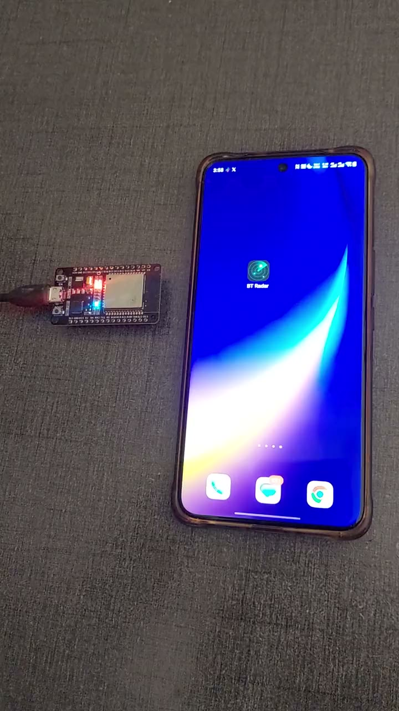

# bt_kit

[](https://pub.dev/packages/bt_kit)
[](https://github.com/velzosoft/bt_kit/actions/workflows/ci.yml)
[](LICENSE)
[](#platform-support)

Bluetooth Classic and BLE for Flutter on Android and iOS. bt_kit calls the platform APIs directly, with no method channels, Pigeon or other Bluetooth plugins, and puts one idiomatic Dart API on top.

- **Correct by default.** Per-peripheral operation queues, a timeout and a `CancelToken` on every operation, sealed exception types, and notification streams that switch themselves on and off.
- **Capability queries** instead of failures discovered at runtime.
- **The whole platform API underneath.** Every Android and iOS Bluetooth API is available next to the unified API, and the two work together.
- **Fakes for app tests** that run on the host, with no radio.

The example app finding an ESP32 board and exchanging data with it in both directions. Click the image to play the video:

<a href="https://github.com/user-attachments/assets/5f4e3e35-089b-467a-b40e-14c3fb6880a4" target="_blank"></a>

## Platform support

| | Android | iOS |
|---|---|---|
| Scanning, connections and GATT client | ✓ | ✓ |
| GATT server and advertising | ✓ | ✓ (local name and service UUIDs) |
| L2CAP channels | ✓ | ✓ |
| Bonding | ✓ | Automatic, on first encrypted access |
| Bluetooth Classic and RFCOMM | ✓ | — |
| MFi accessories | — | ✓ |
| Companion device picker | ✓ (CompanionDeviceManager) | ✓ (AccessorySetupKit) |
| Background delivery | Background scans and companion presence | State restoration |
| Distance | Channel Sounding and RSSI ranging, Android 16 | Channel Sounding, iOS 27 |
| Audio profile state | ✓ | — |
| Minimum version | API 33 (Android 13) | iOS 18, built with Xcode 26 |

bt_kit needs Flutter 3.50 or later.

## Installation

```sh
flutter pub add bt_kit
```

**Android.** Set `minSdk = 33` in `android/app/build.gradle.kts`. The target SDK can stay at Flutter's default. Declare the permissions in `AndroidManifest.xml`:

```xml
<uses-permission android:name="android.permission.BLUETOOTH_SCAN"
    android:usesPermissionFlags="neverForLocation" />
<uses-permission android:name="android.permission.BLUETOOTH_CONNECT" />
```

**iOS.** Set the deployment target to 18.0 and add the usage description to `Info.plist`:

```xml
<key>NSBluetoothAlwaysUsageDescription</key>
<string>Connects to your devices.</string>
```

Some scan results, such as beacons, reveal location, and Android withholds them from apps that declare `neverForLocation`. Apps that need them drop the flag and declare `ACCESS_FINE_LOCATION`; `requestPermissions()` then asks for `BluetoothPermission.location` too, and scans need it. See [doc/platform_notes.md](doc/platform_notes.md#required-app-configuration) for background modes and the optional entries.

## Quick start

```dart
import 'package:bt_kit/bt_kit.dart';

final bt = BtKit.instance;
final heartRate = BluetoothUuid.short(0x180d);
final measurement = BluetoothUuid.short(0x2a37);

final statuses = await bt.requestPermissions();
if (!statuses.values.every((s) => s.isGranted)) return;

final ad = await bt
    .scan(ScanOptions(services: [heartRate], timeout: Duration(seconds: 10)))
    .first;
final device = ad.peripheral;

await device.connect();
await device.discoverServices();
final characteristic = device.characteristic(heartRate, measurement)!;
final subscription = characteristic.subscribe().listen(print);

// Later:
await subscription.cancel();
await device.disconnect();
```

Every one-shot operation accepts a `timeout` and a `CancelToken`, and runs in a per-peripheral queue. Failures are subclasses of the sealed `BluetoothException`:

```dart
try {
  await characteristic.write([0x01]);
} on BluetoothException catch (e) {
  switch (e) {
    case GattException(:final error):
      print('Peripheral refused: $error');
    case DisconnectedException():
      print('Link lost');
    default:
      rethrow;
  }
}
```

Check `bt.capabilities` before using features that not every platform has, such as `requestMtu`, `connectionPriority`, `phy`, `bonding`, `classic`, `externalAccessory`, `channelSounding`, `backgroundEvents` or `gattCacheRefresh`.

## Guide

### Scanning

Filters are alternatives; every field set in one filter must match. Android checks them in the controller where it can, iOS where every filter names a service:

```dart
final scan = bt.scan(ScanOptions(filters: [
  AdvertisementFilter(service: heartRate),
  AdvertisementFilter(nameContains: 'Polar'),
  AdvertisementFilter(manufacturerId: 0x006b, manufacturerData: [0x01]),
]));
```

For a UI, `scanDevices` keeps the latest advertisement of each peripheral in the order they were found, drops those that went quiet, and emits at most twice a second:

```dart
bt
    .scanDevices(
      const ScanOptions(allowDuplicates: true),
      expireAfter: const Duration(seconds: 30),
    )
    .listen((devices) => setState(() => this.devices = devices));
```

On Android, `ScanOptions(legacyOnly: true)` leaves out Bluetooth 5 extended advertisements, and `phy: ScanPhy.leCoded` listens for long-range advertisers only.

Listeners with equal options share one native scan. `bt.isScanning`, `bt.currentScan` and `bt.scanningChanges` report the scan in progress; a scan with other options is refused until it ends.

### Connections

```dart
await device.connect(mtu: 247); // Android 13 needs this for throughput
device.mtuChanges.listen((mtu) => print('MTU $mtu')); // device.mtu now
await device.requestConnectionPriority(ConnectionPriority.high); // Android
final phy = await device.setPreferredPhy(tx: {Phy.le2M}, rx: {Phy.le2M});

device.connectionStates.listen((state) {
  if (state == BluetoothConnectionState.disconnected) {
    print(device.lastDisconnect); // remote, linkLoss, adapterOff, ...
  }
});

// The peripheral changed its GATT database: stale attributes now fail
// with AttributeInvalidatedException.
device.servicesChanged.listen((_) => device.discoverServices());

// A peripheral that changed its database without saying so (Android, through
// a non-SDK interface; check capabilities.gattCacheRefresh):
if (await device.clearGattCache()) await device.discoverServices();
```

`GattService.includedServices` lists the services a service includes; secondary services are in `device.services` on both platforms.

`bt.connectedPeripherals` lists this app's connections, `bt.systemPeripherals()` those of every app, and `bt.events` reports connection, MTU, Services Changed, bond and name changes across all peripherals. `bt.systemConnections()` reports connections any app or the system makes, such as headphones connected in Settings.

### Bonding

Android pairs on request; iOS pairs on its own when the app first uses an encrypted attribute (`capabilities.bonding` is false there):

```dart
await device.createBond(); // may show the pairing dialog
print(device.bondState); // BondState.bonded
final bonded = await bt.bondedPeripherals();

// Android 16 and later remove the bond after the user confirms a companion
// association; earlier versions open the Bluetooth settings instead.
final removed = await device.removeBond();
```

### Values

Every characteristic and descriptor keeps the value last read, written or pushed:

```dart
print(characteristic.lastValue);
characteristic.valueChanges.listen(print); // does not turn pushes on
characteristic.subscribe(mode: NotifyMode.indication).listen(print);
print(characteristic.isNotifying);
```

Only Android can choose between notification and indication when a characteristic supports both (`capabilities.notifyMode`).

Values longer than one write carries, such as a firmware image, go out in pieces of `device.maximumWriteLength()`, with the queue held until the last one:

```dart
await characteristic.writeChunked(
  image,
  onProgress: (sent, total) => print('$sent of $total'),
);
```

### Logging

```dart
BtKit.logLevel = Level.FINE;
Logger.root.level = Level.ALL; // package:logging
Logger.root.onRecord.listen(print);
```

`INFO` covers connections and state changes, `FINE` each queued operation with its time in the queue and its duration, `FINER` the bytes of every value, which can carry personal data, and `WARNING` every platform workaround bt_kit applies.

### Testing your app

`package:bt_kit/testing.dart` replaces `BtKit.instance` with a simulated stack. Fake peripherals serve the same `LocalService` models as a real GATT server:

```dart
import 'package:bt_kit/testing.dart';

late FakeBluetooth bluetooth;

setUp(() {
  bluetooth = FakeBluetooth.install()
    ..add(FakePeripheral(
      id: 'AA:BB:CC:DD:EE:FF',
      advertisement: const AdvertisementData(localName: 'Sensor'),
      services: [heartRateService],
    ));
});
tearDown(FakeBluetooth.uninstall);

testWidgets('shows a refused read', (tester) async {
  bluetooth.failNext(GattError.insufficientAuthentication);
  // ...
});
```

Fakes can also drop the link (`peripheral.disconnect()`, `inRange = false`), turn Bluetooth off, deny permissions, never answer a request (`timeoutNext()`) or change their services while connected.

### Peripheral role

Describe the services as plain data. Reads and writes are answered for you, and handlers are optional:

```dart
final service = BluetoothUuid.parse('6e400001-b5a3-f393-e0a9-e50e24dcca9e');
final counter = LocalCharacteristic(
  BluetoothUuid.parse('6e400002-b5a3-f393-e0a9-e50e24dcca9e'),
  properties: const CharacteristicProperties.of(read: true, notify: true),
  value: [0],
);
final command = LocalCharacteristic(
  BluetoothUuid.parse('6e400003-b5a3-f393-e0a9-e50e24dcca9e'),
  properties: const CharacteristicProperties.of(write: true),
  onWrite: (request) {
    if (request.value.isEmpty) {
      throw GattException(GattError.invalidAttributeValueLength, 'write');
    }
  },
);

await bt.requestPermissions(BtKit.peripheralPermissions);
final server = await bt.openGattServer(
  services: [LocalService(service, [counter, command])],
);
final advertising = await bt.startAdvertising(
  AdvertiseOptions(serviceUuids: [service]),
);

await server.notify(counter, [1]); // To every subscribed central.
```

Android also needs `BLUETOOTH_ADVERTISE` in the manifest. iOS advertises only a local name and service UUIDs.

Change what is advertised without stopping, and ask a connected central for a faster link (iOS):

```dart
await advertising.update(AdvertiseOptions(
  serviceUuids: [service],
  manufacturerData: {0xffff: Uint8List.fromList([reading])}, // Android
));
await server.requestConnectionPriority(central, ConnectionPriority.high);
```

Android can also send periodic advertising alongside an extended, non-connectable advertisement (`capabilities.periodicAdvertising`):

```dart
await bt.startAdvertising(const AdvertiseOptions(
  extended: true,
  connectable: false,
  periodic: PeriodicAdvertising(interval: Duration(milliseconds: 500)),
));
```

### L2CAP channels

An L2CAP channel is a fast, ordered byte stream, well suited to files:

```dart
// Peripheral: publish a PSM and share it, for example in a characteristic.
final l2cap = await bt.publishL2capChannel();
l2cap.channels.listen((channel) => channel.input.listen(save));

// Central: connect to the PSM.
final channel = await device.openL2capChannel(psm);
await channel.write(bytes);
await channel.close();
```

### Bluetooth Classic (Android)

```dart
await for (final found in bt.classic.discover()) {
  print('${found.device.id} ${found.name} ${found.deviceClass?.major}');
}

final printer = await bt.classic.device('00:11:22:33:44:55');
final serial = await printer!.connect(BluetoothUuid.serialPort); // RFCOMM
await serial.write(utf8.encode('hello\n'));

final server = await bt.classic.listen(
  service: BluetoothUuid.serialPort,
  name: 'My app',
);
server.channels.listen((channel) => channel.input.listen(print));
```

`L2capChannel`, `RfcommChannel` and `AccessorySession` are all a `ByteChannel`, so protocol code can run over any of them.

### MFi accessories (iOS)

List each protocol under `UISupportedExternalAccessoryProtocols` in `Info.plist`:

```dart
bt.accessories.changes.listen((event) => print(event));
final accessory = bt.accessories.connected.first;
final session = await accessory.openSession('com.example.sensor');
session.input.listen(print);
```

### Companion devices

The system picker lets the user choose one device for the app, with no Bluetooth permission prompt: `CompanionDeviceManager` on Android, AccessorySetupKit on iOS.

```dart
final watch = await bt.companion.associate(
  CompanionRequest(
    displayName: 'My watch',
    service: heartRate,
    productImage: pngBytes, // iOS
  ),
);
final peripheral = await watch?.peripheral();
```

### Background and restoration

On Android, background scans and companion presence reach the app even when it is not running. A headless engine runs the registered handler:

```dart
@pragma('vm:entry-point')
Future<void> onBackground(BackgroundEvent event) async {
  if (event case BackgroundScanResult(:final advertisements)) {
    // ...
  }
}

await BtKit.registerBackgroundHandler(onBackground);
await bt.startBackgroundScan(ScanOptions(services: [heartRate]));
await bt.companion.startObservingPresence(watch!);
```

While an engine listens to `bt.backgroundEvents`, events go there instead.

On iOS, state restoration relaunches the app for its connections. Configure bt_kit first thing in `main`, on every launch:

```dart
void main() {
  BtKit.configure(const BtKitOptions(restoreIdentifier: 'central'));
  BtKit.instance.restored.listen((restored) {
    if (restored case RestoredCentral(:final peripherals)) {
      // Reconnected peripherals, ready to discover again.
    }
  });
  runApp(const App());
}
```

### Distance

Channel Sounding needs Bluetooth 6.0 on both sides: Android 16 with a bonded peripheral, or iOS 27 with a connected one. Android 16 also estimates distance from signal strength:

```dart
device.measureDistance().listen((m) => print('${m.meters} m'));
device.measureDistance(method: DistanceMethod.rssi).listen(print); // Android
```

Android needs the `RANGING` permission, declared in `AndroidManifest.xml` (`<uses-permission android:name="android.permission.RANGING" />`) and requested with `bt.requestPermissions({BluetoothPermission.ranging})`.

### Audio state (Android)

```dart
final connected = await bt.audio.connections({AudioProfile.a2dp});
bt.audio.changes.listen((c) => print('${c.deviceId} ${c.profile} ${c.state}'));
print(await bt.adapterName()); // the name other devices see
```

## Native APIs

| Import | What you get |
|---|---|
| `package:bt_kit/bt_kit.dart` | The unified API used throughout this guide. Start here. |
| `package:bt_kit/android.dart` | Every public Android Bluetooth API, generated with JNIgen. |
| `package:bt_kit/ios.dart` | CoreBluetooth, AccessorySetupKit and ExternalAccessory, generated with FFIgen. |

The documentation calls the native APIs Layer 1 and the unified API Layer 2. Every Layer 2 object exposes the native object behind it, and all three libraries can be imported together without prefixes.

```dart
import 'package:bt_kit/android.dart';

final context = androidApplicationContext.as(Context.type);
final manager = context
    .getSystemService$1(Context.BLUETOOTH_SERVICE!)!
    .as(BluetoothManager.type);
final callback = ScanCallback.implement(
  onScanResult: (type, result) => print(result?.device?.address),
);
manager.adapter!.bluetoothLeScanner!.startScan(callback);
```

```dart
import 'package:bt_kit/ios.dart';

final delegate = CBCentralManagerDelegate.implement(
  centralManagerDidUpdateState_: (central) => print(central.state),
);
final central = CBCentralManager.alloc().initWithDelegate(delegate, queue: null);
```

Reach Layer 1 from Layer 2 through `native`, and run Layer 1 calls inside `exclusive` so they never overlap a queued Layer 2 operation. For example, Android 15's digital car key priority, which Layer 2 does not wrap:

```dart
await device.exclusive(() async {
  device.native.android?.gatt?.requestConnectionPriority(
    BluetoothGatt.CONNECTION_PRIORITY_DCK,
  );
});
```

## Documentation

- [Architecture and directory structure](doc/architecture.md)
- [Layer 1: inventory, coverage matrix and exposure rules](doc/layer1.md). Generated inventories: [Android](doc/inventory/android.md), [iOS](doc/inventory/ios.md)
- [Binding generation and callback integration](doc/bindings.md)
- [Resources, lifecycle, threading, permissions and security](doc/runtime.md)
- [Platform behavior and interop limits](doc/platform_notes.md)
- [Testing](doc/testing.md)
- [Example app](example/README.md)

## Contributing

Bug reports and pull requests are welcome; see [CONTRIBUTING.md](CONTRIBUTING.md).

## Licence

bt_kit is developed and maintained by [Velzosoft](https://github.com/velzosoft) and released under the [BSD-3-Clause licence](LICENSE).
