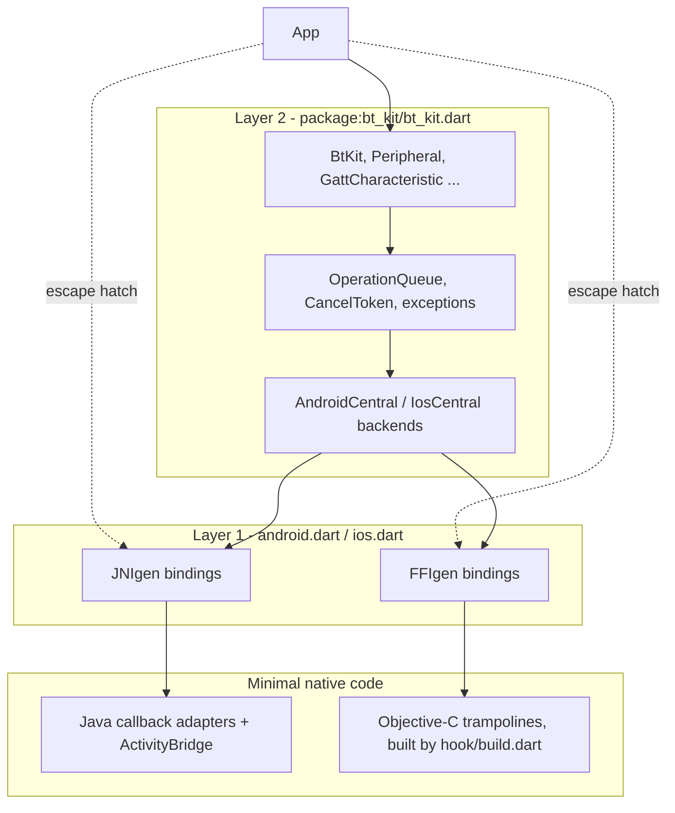

# Architecture

bt_kit is one Flutter package with two API layers and separate entry points.

| Entry point | Layer | Built from | Audience |
|---|---|---|---|
| `package:bt_kit/bt_kit.dart` | 2: unified Dart API | Layer 1 only | Most apps; the documented default |
| `package:bt_kit/android.dart` | 1: Android | JNIgen | Full Android control |
| `package:bt_kit/ios.dart` | 1: iOS | FFIgen (Objective-C) | Full iOS control |

There are no method channels, event channels, Pigeon or third-party Bluetooth plugins. Dart calls the platform APIs directly. Native code is limited to what Dart cannot express (see [Native code](#native-code)).



## Directory structure

```
bt_kit/
├── lib/
│   ├── bt_kit.dart                 Layer 2 entry point
│   ├── testing.dart                Fakes for app tests
│   ├── android.dart                Layer 1 entry point, Android   (generated)
│   ├── ios.dart                    Layer 1 entry point, iOS       (generated)
│   └── src/
│       ├── native/                 Layer 1
│       │   ├── android/
│       │   │   ├── bindings.g.dart JNIgen output                  (generated)
│       │   │   └── bindings.dart   Barrel Layer 2 imports         (generated)
│       │   └── ios/
│       │       ├── bindings.g.dart FFIgen output                  (generated)
│       │       └── bindings.dart   Barrel Layer 2 imports         (generated)
│       ├── core/                   Platform-neutral building blocks
│       ├── models/                 Dart value types
│       ├── central/                BtKit, peripherals, bonding, restoration
│       ├── peripheral_role/        GATT server, local attributes, advertising
│       ├── channels/               ByteChannel: L2CAP, RFCOMM, accessory sessions
│       ├── classic/                Bluetooth Classic discovery and devices
│       ├── accessories/            MFi accessories (ExternalAccessory)
│       ├── companion/              The companion device picker
│       ├── background/             Background events
│       ├── audio/                  Audio profile state
│       ├── testing/                FakeBluetooth: a backend with no radio
│       └── platform/               Internal backends on top of Layer 1
│           ├── central_backend.dart          Central role contract
│           ├── peripheral_role_backend.dart  Peripheral role contract
│           ├── channel_backend.dart          Byte channel contracts
│           ├── bond_backend.dart, classic_backend.dart, accessory_backend.dart,
│           │   companion_backend.dart, background_backend.dart, audio_backend.dart
│           ├── unsupported.dart              Backends for what a platform lacks
│           ├── request_slot.dart
│           ├── native_scan_filters.dart      What each platform filters natively
│           ├── android/            Includes socket_io.dart (isolate workers)
│           └── ios/
├── android/                        Gradle module: adapters, bridge, plugin
│   └── src/main/java/dev/btkit/
│       ├── ActivityBridge.java     Activity results for Dart
│       ├── BackgroundDelivery.java Background events for Dart, headless engine
│       ├── BackgroundScanReceiver.java   PendingIntent scan results
│       ├── CompanionPresenceService.java Companion presence (declared by apps)
│       ├── BtKitPlugin.java        Connects the bridge to each engine
│       └── adapters/               One per abstract callback class (generated)
├── src/ios/
│   ├── bt_kit.h                    Umbrella header FFIgen parses
│   └── bindings.g.m                Trampolines for blocks and delegates (generated)
├── hook/build.dart                 Compiles src/ios for iOS builds (native assets)
├── tool/                           Binding generators and their exposure rules
│   ├── generate.dart
│   ├── common/
│   ├── android/
│   └── ios/
├── doc/                            Design documents and generated inventories
├── test/                           Host unit tests
└── example/                        Bluetooth Radar, the example app and on-device tests
```

Every generated file says so in its first line and is rebuilt by `dart run tool/generate.dart`. Nothing generated is edited by hand.

## Layer 1

Layer 1 is the platform API, exposed by rules rather than by hand-picked members (see [layer1.md](layer1.md)).

- **Android.** JNIgen binds `android.bluetooth`, `android.bluetooth.le`, `android.companion` and `android.ranging` from the API 37 SDK, together with the platform classes needed to drive them (`Context`, `Intent`, `ParcelUuid` ...). Abstract callback classes get an `implement` factory.
- **iOS.** FFIgen binds CoreBluetooth, AccessorySetupKit and ExternalAccessory from the iOS SDK, with `NSUUID` as a support type. Delegate protocols get an `implement` factory.

Layer 1 adds no abstractions. Names, parameters, constants and semantics are the platform's own.

## Layer 2

Layer 2 is a convenience layer written only against Layer 1. It covers the central and peripheral roles, L2CAP, bonding, Bluetooth Classic, MFi accessories, companion devices, background delivery, state restoration, ranging and audio state.

| Concern | Where |
|---|---|
| Entry point, permissions, adapter state, scanning | `central/bt_kit.dart` |
| Shared native scan sessions | `central/scan_session.dart` |
| Connections and GATT operations | `central/peripheral.dart`, `central/gatt.dart` |
| Local services, request handling, subscriptions, notifications | `peripheral_role/gatt_server.dart`, `peripheral_role/local_gatt.dart` |
| Advertising | `peripheral_role/advertising_session.dart` |
| Byte streams: L2CAP, RFCOMM, accessory sessions | `channels/byte_channel.dart` and its parts |
| Bonding, shared by peripherals and Classic devices | `central/bonding.dart` |
| Classic discovery, devices and RFCOMM servers | `classic/classic_bluetooth.dart` |
| MFi accessories | `accessories/external_accessories.dart` |
| Companion picker, associations and presence | `companion/companion_devices.dart` |
| Background events and the headless entry point | `background/background_event.dart`, `central/bt_kit_background.dart` |
| State restoration | `central/restored_state.dart` |
| Distance measurement | `Peripheral.measureDistance` |
| Audio profile state | `audio/audio_profiles.dart` |
| One operation at a time, with timeout and cancellation | `core/operation_queue.dart` |
| Errors | `core/exceptions.dart` (sealed) |
| Access to Layer 1 objects | `core/native_handle.dart`, `central/native_types.dart` |
| Platform backends | `platform/android`, `platform/ios` |

Public objects never talk to the platform directly. They call a backend: `CentralBackend` and `PeripheralBackend` (central role), `PeripheralRoleBackend` and `ServerBackend` (peripheral role), `ByteChannelBackend` (L2CAP, RFCOMM and accessory sessions), `BondBackend`, `ClassicBackend`, `AccessoryBackend`, `CompanionBackend`, `BackgroundBackend` and `AudioBackend`. A platform without a feature gets the matching backend from `unsupported.dart`. A backend only translates. Each call issues the Layer 1 requests it maps to, and platform callbacks come back as plain Dart values and events. The public objects own the policy: queueing, timeouts, cancellation, permission and adapter checks, request validation, long reads and subscription tracking. Because that policy is platform-neutral, it is unit-tested against fake backends.

### Using both layers together

- Every Layer 2 object exposes its Layer 1 object through `native`, a `NativeHandle<Android, Ios>`:

  ```dart
  final gatt = peripheral.native.android?.gatt;            // BluetoothGatt
  final cb = characteristic.native.ios;                    // CBCharacteristic
  ```

- `Peripheral.exclusive` holds the connection's operation queue while Layer 1 calls run, so they never overlap a Layer 2 request.
- Layer 2 owns the callbacks and delegates of the objects it creates. Do not replace the delegate of a `CBPeripheral` or the callback of a `BluetoothGatt` that Layer 2 manages. Create your own Layer 1 objects when you need your own callbacks.
- The two layers export disjoint names, and Layer 1 never shadows `dart:core`. A test enforces both (`test/layers_test.dart`), so all three libraries can be imported without prefixes.

## Native code

| Code | Why Dart cannot do it |
|---|---|
| `adapters/*Adapter.java` (generated) | JNIgen implements Java interfaces, not abstract classes. Each adapter subclasses one callback class and forwards to a listener interface Dart implements. |
| `ActivityBridge.java`, `BtKitPlugin.java` | Permission and `startActivityForResult` results arrive in `Activity` callbacks, which only a Flutter plugin class can receive. |
| `BackgroundScanReceiver.java`, `CompanionPresenceService.java` | The system delivers background scan results and companion presence to manifest components, which must be Java classes. |
| `BackgroundDelivery.java` | When those events arrive with no Dart listener, only Java can start a headless Flutter engine to run the app's handler. |
| `src/ios/bindings.g.m` (generated) | Objective-C blocks and protocol methods need C trampolines to call into Dart. |

Everything else, including parsing, state machines and error mapping, is Dart.
